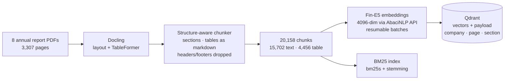
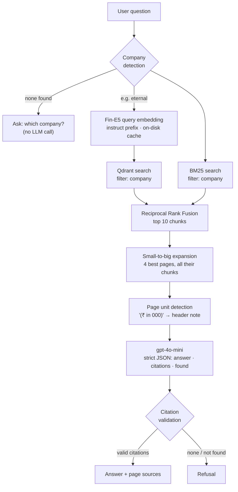
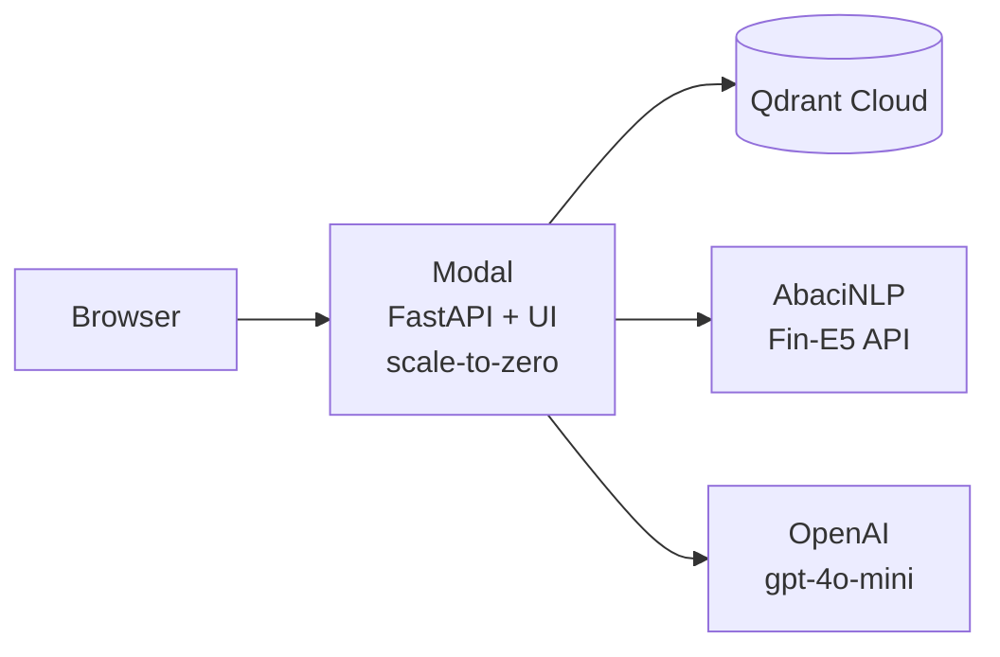

<div align="center">

# 📊 Annualyst

**Cited question answering over Indian annual reports — every answer points to the page it came from.**

8 FY2025-26 annual reports · 3,307 pages · 20,158 chunks · hybrid retrieval · page-level citations · refuses when the answer isn't there

[](<YOUR_MODAL_URL>)
[](<YOUR_LOOM_URL>)


</div>

---

## At a glance

| | Baseline | **Annualyst** | Change |
|---|:---:|:---:|:---:|
| Correct page ranked **#1** (Recall@1) | 0.30 | **0.61** | **2.0×** |
| Correct page in **top 5** (Recall@5) | 0.58 | **0.85** | +0.27 |
| Correct page in **top 10** (Recall@10) | 0.73 | **0.91** | +0.18 |
| Mean Reciprocal Rank | 0.432 | **0.721** | +67% |
| Cost per answer | — | **≈ $0.0006** | |
| Latency per answer | — | **≈ 2–3.5 s** | retrieval ≈ 20 ms |

> Baseline = PyMuPDF text + `bge-small` dense search in FAISS. Measured on a 33-question eval set (see [Evaluation](#-evaluation) for its limits).

<!-- Add a screenshot of the UI here:  -->

---

## Table of contents

- [What it does](#-what-it-does)
- [Architecture](#-architecture)
- [How a question is answered](#-how-a-question-is-answered)
- [Evaluation](#-evaluation)
- [Engineering decisions](#-engineering-decisions-and-what-the-numbers-said)
- [Bugs found and fixed](#-bugs-the-eval-and-testing-caught)
- [Run it yourself](#-run-it-yourself)
- [API](#-api)
- [Deployment](#-deployment)
- [Repository layout](#-repository-layout)
- [Limitations and roadmap](#-limitations-and-roadmap)

---

## 🔎 What it does

Ask a question in plain English about any of these companies' FY2025-26 annual reports:

| Banking | FMCG & Consumer | Tech | Internet |
|---|---|---|---|
| HDFC Bank · ICICI Bank | ITC · Asian Paints · Titan | Infosys | Eternal (Zomato) · Nykaa |

```text
Q: What was HDFC Bank's standalone net profit in FY26?

A: HDFC Bank's standalone net profit for the year ended March 31, 2026, was
   746,712,933 (₹ in '000), i.e. ₹74,671.29 crore.

Sources: HDFC Bank · p.354   (Standalone Profit and Loss Account)
```

- **Cites pages.** Every claim links to the chunk and PDF page it came from; citations the model invents are dropped.
- **Refuses instead of guessing.** If the retrieved pages don't contain the answer, it says so.
- **Knows which company you mean.** "Blinkit" → Eternal, "Tanishq" → Titan, "HDB Financial" → HDFC Bank. If no company is named, it asks.
- **Gets units right.** Financial statements printed in ₹ '000 or ₹ lakh are converted correctly instead of being mislabelled as crore.

---

## 🏗 Architecture

### Offline: building the index (run once)



### Online: answering a question



### Serving



Locally the same app runs with `docker compose` (app + Qdrant containers).

---

## 🧭 How a question is answered

| Stage | What happens | Why |
|---|---|---|
| **1. Company detection** | Regex over company names, subsidiaries and brands (Zomato, Blinkit, Tanishq, CaratLane, HDB Financial, Aashirvaad…). A UI dropdown can override it. | Most wrong answers came from the *wrong company's* report (Eternal ↔ Nykaa, HDFC ↔ ICICI). |
| **2. Hybrid retrieval** | Fin-E5 dense search in Qdrant + BM25 keyword search, both restricted to the detected company, fused with Reciprocal Rank Fusion (k = 60). | Dense search handles paraphrases; BM25 nails exact terms like "capital adequacy ratio" or "Schedule 18". |
| **3. Small-to-big** | The 4 best *pages* among the top 10 chunks are expanded to all of their chunks (≤ 12k characters). | Search on small, precise chunks — but answer from whole pages, so a heading chunk brings its table along. |
| **4. Unit detection** | Each page is scanned for unit lines like `(₹ in '000)`, `(₹ in lakh)`, `(₹ crore)` and the unit is written into the header of every chunk from that page. | Statements state units once per page; without this the model reported ₹ '000 figures as crore. |
| **5. Generation** | gpt-4o-mini, temperature 0, strict JSON schema `{answer, citations, found}`. | Structured output makes citations machine-checkable. |
| **6. Validation** | Citations not among the provided chunks are dropped; an answer with no valid citation becomes a refusal. | The UI never shows an answer it can't point to. |

---

## 📏 Evaluation

**Metric:** page-level retrieval — a hit means the right company **and** a gold page appear in the top *k*. Recall@1/5/10 and MRR@10.
**Eval set:** 33 questions over 3 reports (HDFC Bank 15, Eternal 12, Asian Paints 6), typed as table (10), prose (9), multi-column (8) and BRSR (6).

### The ablation path (one change at a time)

| # | Configuration | R@1 | R@5 | R@10 | MRR |
|:-:|---|:---:|:---:|:---:|:---:|
| 1 | PyMuPDF text · bge-small · dense *(baseline)* | 0.30 | 0.58 | 0.73 | 0.432 |
| 2 | Docling chunks · bge-small · dense | 0.18 | 0.58 | 0.73 | 0.363 |
| 3 | Docling · bge-small · **hybrid (BM25 + dense, RRF)** | 0.24 | 0.70 | 0.79 | 0.439 |
| 4 | Docling · **Fin-E5** · dense | 0.42 | 0.73 | 0.82 | 0.547 |
| 5 | Docling · Fin-E5 · hybrid | 0.52 | 0.79 | 0.79 | 0.626 |
| 6 | + **Qdrant** (sanity check — must equal row 5) | 0.52 | 0.79 | 0.79 | 0.626 |
| 7 | + **company filter** | 0.61 | 0.85 | 0.88 | 0.715 |
| 8 | + **subsidiary / brand aliases** ✅ *shipped* | **0.61** | **0.85** | **0.91** | **0.721** |
| ✗ | row 5 + MiniLM cross-encoder rerank | 0.45 | 0.67 | 0.82 | 0.557 |
| ✗ | row 5 + bge-reranker-base | 0.33 | 0.64 | 0.76 | 0.460 |

<details>
<summary><b>Results by question type (Recall@5)</b></summary>

| Type | Baseline | Shipped |
|---|:---:|:---:|
| BRSR (sustainability tables) | 0.50 | **1.00** |
| Multi-column layouts | 0.38 | **1.00** |
| Prose | 0.56 | **0.78** |
| Tables | **0.80** | 0.70 |

Tables are the one regression: Docling's markdown serialization of multi-level headers is weaker than raw PyMuPDF text for keyword-heavy table questions. See the roadmap.
</details>

<details>
<summary><b>Diagnostic rows</b></summary>

| Configuration | R@1 | R@5 | R@10 | MRR |
|---|:---:|:---:|:---:|:---:|
| Docling · BM25 only | 0.36 | 0.76 | 0.79 | 0.537 |
| PyMuPDF · bge-small · hybrid | 0.42 | 0.73 | 0.82 | 0.547 |

BM25 alone scores well because the questions were drafted from page text and share its vocabulary — one reason the shipped system keeps a dense component for paraphrased real-world questions.
</details>

> **Honest caveats.** 33 questions is small (one question = 0.03), they cover 3 of the 8 reports, they were drafted by an LLM from the report pages, and their gold pages are not yet hand-verified. Treat differences under ~0.06 as noise. A 100-question, hand-verified set across all 8 companies is on the roadmap.

---

## 🧠 Engineering decisions (and what the numbers said)

<details open>
<summary><b>1. A finance-tuned embedding model beat a bigger parser change</b></summary>

Swapping `bge-small` (33M params) for **Fin-E5** (finance-adapted e5-Mistral-7B, served via the AbaciNLP API) on the *same* Docling chunks lifted R@1 **0.18 → 0.42** and MRR **0.36 → 0.55**. Indexing 20,158 chunks took 3.38M tokens; question vectors are cached on disk so re-running evals costs nothing.
</details>

<details>
<summary><b>2. The reranker was built, measured — and not shipped</b></summary>

Cross-encoder rerankers are standard advice, so I benchmarked two on the hybrid top-30. Both **hurt** after the Fin-E5 upgrade (MRR 0.626 → 0.557 with MiniLM, → 0.460 with bge-reranker-base), while adding 1–6 s per question on CPU. The rerankers are general web-search models and are weaker than the finance-tuned first stage; chunks also don't name their company, so Eternal and Nykaa passages looked alike to them.
</details>

<details>
<summary><b>3. Filter by company before ranking</b></summary>

6 of the 7 remaining misses had other companies' pages in the top 3. Moving from FAISS to **Qdrant** gave payload filtering inside the search (and BM25 is masked the same way). Detection is from question text only — never from the eval labels — and got **30/33 right with 0 wrong**; the 3 misses say "the Group" or "the bank", for which the app asks which company.
</details>

<details>
<summary><b>4. Search small, answer big</b></summary>

Docling chunks average ~167 tokens — great for precise search, too small to answer from. The answer step expands the top pages to all their chunks (small-to-big / parent-page retrieval), costing ≈ $0.0006 per question instead of ≈ $0.0002.
</details>

<details>
<summary><b>5. Migrations are proven, not assumed</b></summary>

Every infrastructure change had a sanity row that must reproduce the previous numbers exactly — e.g. FAISS → Qdrant (exact search) reproduced 0.52 / 0.79 / 0.79 / 0.626 to the digit before the company filter was added.
</details>

---

## 🐛 Bugs the eval and testing caught

| Bug | Symptom | Fix |
|---|---|---|
| Chunker dropped the end of every page | Baseline numbers were understated | Fixed indentation in `chunk_text`; all baseline rows re-run before comparing |
| Wrong bge query prefix | Silent dense-retrieval degradation | Corrected instruction string |
| Heading-only chunk retrieved | "Not found" although the right page was found — its table was a separate chunk | Small-to-big page expansion |
| **₹ '000 reported as crore** | "746,712.93 crore" instead of **₹74,671.29 crore** — wrong by 10× | Page-level unit detection (`(C in '000)` — the ₹ sign extracts as `C`) + exact-number prompt rules |
| Resuming from a dry-run checkpoint | 24 chunks silently missing vectors | Final count check caught it; checkpoints now validated by size |

---

## 🚀 Run it yourself

### Prerequisites
Python 3.11 · [uv](https://docs.astral.sh/uv/) · Docker · API keys for OpenAI and AbaciNLP (Fin-E5).

### 1. Set up
```bash
git clone https://github.com/Divyanshu4501/annualyst-rag.git
cd annualyst-rag
uv sync
cat > .env <<'EOF'
OPENAI_API_KEY=sk-...
ABACI_API_KEY=...
QDRANT_URL=http://localhost:6333
EOF
```
Place the annual report PDFs in `data/raw/<company>_fy26.pdf` (`data/` is not committed).

### 2. Build the index
```bash
uv run python -m rag.parse_docling                         # PDF → Docling JSON (slow, CPU, resumable)
uv run python -m rag.chunk_docling                         # → data/chunks/docling_chunks.jsonl
uv run python -m rag.embed_api \
    --chunks data/chunks/docling_chunks.jsonl \
    --out data/index/docling_fine5                         # Fin-E5 vectors (resumable)
docker compose up -d qdrant
uv run python -m rag.qdrant_store --index data/index/docling_fine5
```

### 3. Ask questions
```bash
uv run python -m rag.answer "What was HDFC Bank's standalone net profit in FY26?" --show-context
docker compose up --build                                  # UI at http://localhost:8000
```

### 4. Reproduce the evaluation
```bash
uv run python eval/run_eval.py --index data/index/docling_fine5 --mode hybrid --store qdrant --company-filter
uv run python eval/plot_results.py
uv run python scripts/inspect_misses.py --index data/index/docling_fine5 --store qdrant --company-filter
```

---

## 🔌 API

| Method | Path | Description |
|---|---|---|
| `GET` | `/` | Web UI |
| `GET` | `/health` | Status, chunk count, store, model |
| `GET` | `/companies` | Selectable companies |
| `POST` | `/ask` | Answer a question |
| `GET` | `/docs` | Interactive OpenAPI docs |

```bash
curl -X POST <URL>/ask -H "Content-Type: application/json" \
  -d '{"question": "What was the capital adequacy ratio?", "company": "hdfcbank"}'
```

<details>
<summary><b>Response</b></summary>

```json
{
  "answer": "The capital adequacy ratio of HDFC Bank as of March 31, 2026, was 19.71%.",
  "found": true,
  "reason": null,
  "companies": ["hdfcbank"],
  "sources": [
    {"company_name": "HDFC Bank", "page": 378, "chunk_id": "hdfcbank_dl_02014", "snippet": "Capital adequacy | CET 1 capital ..."},
    {"company_name": "HDFC Bank", "page": 253, "chunk_id": "hdfcbank_dl_01234", "snippet": "your Bank's total CAR ... stood at 19.7 per cent ..."}
  ],
  "timings": {"embed_s": 1.72, "retrieve_s": 0.018, "llm_s": 1.498, "total_s": 3.236},
  "tokens": {"prompt_tokens": 4263, "completion_tokens": 55},
  "cost_usd": 0.000672
}
```
`reason` is `no_company`, `not_in_context` or `no_valid_citations` when `found` is `false`.
</details>

---

## ☁️ Deployment

| Component | Where | Notes |
|---|---|---|
| App (FastAPI + UI) | **Modal** (`modal_app.py`) | 1 CPU · 1 GB · scales to zero · warm for 5 min after a request · first request after idle ≈ 10–20 s |
| Vectors | **Qdrant Cloud** | 20,158 × 4096 cosine, payload-indexed on `company` |
| Secrets | Modal secret `annualyst` | `OPENAI_API_KEY`, `ABACI_API_KEY`, `QDRANT_URL`, `QDRANT_API_KEY` — never in the image |
| Local | `docker compose` | slim image (no PyTorch / Docling): `requirements-serve.txt` |

```bash
uv run modal secret create annualyst --from-dotenv .env.modal
uv run modal deploy modal_app.py
```

---

## 📁 Repository layout

```text
annualyst-rag/
├── rag/
│   ├── parse_docling.py     # PDF → Docling JSON/markdown (TableFormer)
│   ├── chunk_docling.py     # structure-aware chunking (sections, tables)
│   ├── ingest_pymupdf.py    # baseline per-page chunker
│   ├── index.py             # bge-small + FAISS (baseline)
│   ├── embed_api.py         # Fin-E5 embeddings, retries, resumable checkpoints
│   ├── qdrant_store.py      # upload to Qdrant, company filter
│   ├── companies.py         # company / subsidiary / brand detection
│   ├── hybrid.py            # dense (FAISS/Qdrant) + BM25 + RRF, query cache
│   ├── rerank.py            # cross-encoder rerankers (measured, not shipped)
│   └── answer.py            # page expansion, unit detection, LLM, citation checks
├── app/
│   ├── main.py              # FastAPI service
│   └── static/index.html    # single-page UI
├── eval/
│   ├── questions/           # eval questions per company
│   ├── run_eval.py          # Recall@k / MRR harness
│   ├── plot_results.py      # ablation plots + table
│   └── results/             # every configuration's per-question results
├── scripts/inspect_misses.py
├── modal_app.py             # production deployment
├── Dockerfile · docker-compose.yml · requirements-serve.txt
└── pyproject.toml · uv.lock
```

---

## 🗺 Limitations and roadmap

**Known limitations**
- Eval set is small (33 questions, 3 companies) and its gold pages are LLM-drafted, not yet verified.
- Table questions regressed vs raw-text parsing (0.80 → 0.70 R@5).
- Charts and image-only pages (~19) are not indexed.
- Comparison questions across two companies get only 4 pages of context and may cover one company.
- Single-tenant demo: one request is processed at a time.

**Next**
- [ ] 100-question eval across all 8 companies, hand-verified gold pages, 70/30 dev/test split, answer-level metrics (correctness, faithfulness, citation accuracy, refusal accuracy)
- [ ] Better table serialization (flatten multi-level headers, row-as-sentence) and re-measure
- [ ] Chart text via a vision model as a measured ablation
- [ ] CI (lint + tests) on every push
- [ ] Fallback to a local embedding model if the Fin-E5 API is unavailable

---

## 🙏 Acknowledgements

[Docling](https://github.com/docling-project/docling) for layout-aware parsing ·
[FinMTEB / Fin-E5](https://arxiv.org/abs/2502.10990) (Tang & Yang) and [AbaciNLP](https://abacinlp.com) for the finance embedding model ·
[Qdrant](https://qdrant.tech) · [bm25s](https://github.com/xhluca/bm25s) · [FastAPI](https://fastapi.tiangolo.com) · [Modal](https://modal.com).
Annual reports are publicly available documents of the respective companies.

<div align="center">

Built by **Divyanshu Sharma** · B.Tech AI/ML, BIT Mesra

</div>
